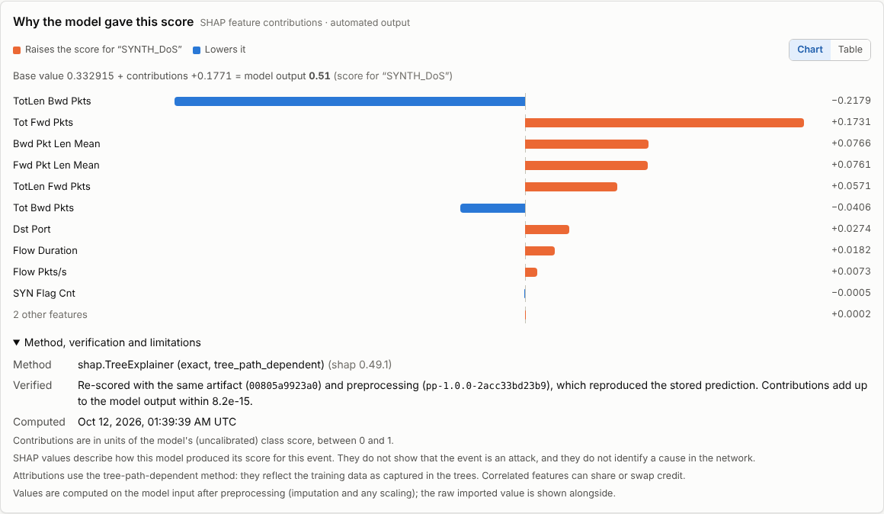

# Adaptive IDS

**Local-first machine-learning network intrusion detection with drift monitoring, explainable alerts and
governed model updates.**

Adaptive IDS turns an MSc research project into a working platform. It imports authorised network-flow data,
scores it with a verified model, and raises alerts that an analyst investigates with an exact explanation of
each score. It watches for four kinds of drift separately, and lets a new model replace the current one only
after a paired evaluation and an explicit, audited approval. It runs entirely on one machine: no cloud
services, no external AI APIs and no telemetry.

[](docs/demo/adaptive-ids-demo.mp4)

*Above: an alert's SHAP explanation. Click for the [recorded walkthrough](docs/demo/adaptive-ids-demo.mp4)
([narration script](docs/demo-script.md)).*

> **Version 1.0.0.** Meets the specification's definition of done. 206 Python tests and 18 web tests; CI on
> Ubuntu, Windows and PostgreSQL with blocking security scans. Every result is labelled by provenance; the
> dissertation's own numbers are quoted only as "reported". No customer pilot has run yet. See
> [Phase 9](docs/phase-9-commercial-validation.md).

## What the evidence shows

Read the **[technical case study](docs/case-study.md)** for the full story. In short:

- **The dissertation result was reproduced exactly, and then explained.**
  - All 15 reported supervised metrics reproduce to 4 decimal places.
  - The data was NSL-KDD `KDDTest+`, not CIC-IDS2018 as labelled, and an annotation column (the
    difficulty level) was used as a feature.
  - On the official train/test split, Random Forest accuracy is **77.2 %** and attack recall **61.9 %**,
    not 99.6 %. ([Review](docs/msc-notebook-review.md))
- **Governance catches a tempting regression.** An ExtraTrees candidate improves recall by 3.3 points on
  real NSL-KDD data. But its false-positive rate rises by 1.7 points, beyond the 0.5-point margin, so the
  verdict is "fail" until an admin makes a justified override.
  ([Phase 6](docs/phase-6-governance.md))
- **Explanations find a concrete model weakness.** Of the 52 normal test records with fragment errors, all
  52 are flagged as attacks, because fragment errors never occur in normal training data. That is 22 % of
  all false positives. ([Explanations](docs/model-explanations.md))
- **Tested over time on CSE-CIC-IDS2018.** Models only ever predict later days they have never seen.
  - **Static model:** one trained on the first day catches almost nothing afterwards.
  - **Adaptation:** helps when an attack type returns (web attacks: 0.2 % to 56 % recall at 0 % FPR).
  - **The gate:** blocked three updates that would have raised false positives.
  - **New attacks:** no strategy detects a new attack type on its first day.

  ([Evaluation](docs/cic-ids2018-evaluation.md))
- **It runs on a laptop-class machine.** On 4 cores:
  - **Throughput:** 2,400–3,800 events per second batch scoring.
  - **Memory:** a real 1-million-row day file imported and scored in about 10 minutes, peaking at 9.3 GB.
    Smaller files need under 1.4 GB.
  - **Storage:** 1–3 GB per million events.
  ([Benchmark](docs/phase-9-commercial-validation.md))

## What it does

| | |
|---|---|
| **Import** | Validated CSV flow imports against versioned feature schemas, with per-row rejection reasons and leakage guards |
| **Detect** | Predictions from hash-verified models only, each recording the model version, preprocessing version and decision rule |
| **Investigate** | Alerts with rule-based severity, assignment, notes, history and incidents; exact SHAP explanations checked against the stored prediction |
| **Monitor drift** | Feature, prediction, performance and suspected concept drift, kept separate; reviewed events; controlled experiments |
| **Govern models** | Paired candidate-vs-baseline evaluation with non-inferiority gates, gated approval, restorability checks and rollback |
| **Operate safely** | Admin, analyst and viewer roles; throttled sign-in; audit log; retention; verified backup and restore; strict HTTP hardening |

Phase-by-phase details: [`docs/features.md`](docs/features.md).

## Quick start (Windows PowerShell)

```powershell
py -3.10 -m venv .venv
.\.venv\Scripts\Activate.ps1
python -m pip install --upgrade pip
pip install -r requirements.lock.txt
pip install -e . --no-deps
python -m pytest
```

On Linux or macOS, use `python3.10 -m venv .venv` and `source .venv/bin/activate`.
No GPU, cloud account or API key is required.

## Run the API

```powershell
copy .env.example .env                 # SQLite by default; PostgreSQL: docker compose up -d postgres
adaptive-ids db-upgrade
adaptive-ids create-user admin --role admin
adaptive-ids demo --admin admin        # optional: repeatable SYNTHETIC demo data, model and alerts
adaptive-ids serve                     # API docs: http://127.0.0.1:8000/docs
```

Web UI: `cd apps/web && npm ci && npm run build`, then set `ADAPTIVE_IDS_WEB_DIST=apps/web/dist` and start
`adaptive-ids serve` again; the dashboard is at http://127.0.0.1:8000. For hot reload, run `npm run dev` instead
(http://localhost:5173). Requires Node.js 20.19+ or 22.12+.

## Demo on synthetic data (ML engine only)

```powershell
adaptive-ids make-synthetic                       # data/sample/flows_SYNTHETIC_demo.csv
adaptive-ids run configs/experiments/synthetic-demo.json
# -> experiments/runs/synthetic-demo-rf-<time>/report.md
```

The synthetic classes are easy to separate, so near-perfect scores are expected.
They show that the software works, **not** how well it detects intrusions.

## Screenshots

Web dashboard, captured from the running app on 2026-10-11 and 2026-10-12. Images marked NSL-KDD use the public
NSL-KDD data; all others use the SYNTHETIC demo:

| | |
|---|---|
| [Dashboard](docs/screenshots/ui-01-dashboard.png) | [Dashboard (dark)](docs/screenshots/ui-02-dashboard-dark.png) |
| [Alert investigation](docs/screenshots/ui-03-alert-investigation.png) | [Incident](docs/screenshots/ui-04-incident.png) |
| [Model governance](docs/screenshots/ui-05-model.png) | [Phone width](docs/screenshots/ui-06-mobile.png) |
| [Drift Monitor](docs/screenshots/ui-07-drift-monitor.png) | [Drift analysis](docs/screenshots/ui-08-drift-analysis.png) |
| [Candidate evaluation (NSL-KDD)](docs/screenshots/ui-09-candidate-evaluation.png) | [Approve with override](docs/screenshots/ui-10-approve-override.png) |
| [Model governance and restorability](docs/screenshots/ui-11-model-governance.png) | [Candidate evaluation (dark)](docs/screenshots/ui-12-candidate-evaluation-dark.png) |
| [Read-only viewer](docs/screenshots/ui-13-viewer-read-only.png) | [Account security and user admin](docs/screenshots/ui-14-account-security.png) |
| [Sign-in throttling](docs/screenshots/ui-15-login-throttled.png) | [Alert explanation (SHAP)](docs/screenshots/ui-16-alert-explanation.png) |
| [Alert explanation (dark)](docs/screenshots/ui-17-alert-explanation-dark.png) | [NSL-KDD false positive explained](docs/screenshots/ui-18-nsl-kdd-false-positive-explanation.png) |

Engine output captured on 2026-10-10 (images 2–4 use SYNTHETIC demo data; the scores show the pipeline works, not detection performance):

| | |
|---|---|
| [Test suite](docs/screenshots/01-test-suite.png) | [CLI experiment run](docs/screenshots/02-cli-experiment-run.png) |
| [Experiment report](docs/screenshots/03-experiment-report.png) | [Import validation](docs/screenshots/04-import-validation.png) |
| [Safety checks](docs/screenshots/05-safety-checks.png) | |

## Documentation

| Topic | Document |
|---|---|
| Technical case study | [`docs/case-study.md`](docs/case-study.md) |
| Architecture and module map | [`docs/architecture.md`](docs/architecture.md) |
| MSc notebook review and reproduction | [`docs/msc-notebook-review.md`](docs/msc-notebook-review.md), [`docs/reproducing-the-baseline.md`](docs/reproducing-the-baseline.md) |
| Backend, dashboard, drift, governance | [Phase 3](docs/phase-3-backend.md), [Phase 4](docs/phase-4-frontend.md), [Phase 5](docs/phase-5-drift.md), [Phase 6](docs/phase-6-governance.md) |
| Security, threat model, operations runbook | [`docs/phase-7-security.md`](docs/phase-7-security.md), [`SECURITY.md`](SECURITY.md) |
| Model explanations | [`docs/model-explanations.md`](docs/model-explanations.md) |
| Chronological evaluation on CSE-CIC-IDS2018 | [`docs/cic-ids2018-evaluation.md`](docs/cic-ids2018-evaluation.md) |
| Demo recording and script | [`docs/demo-script.md`](docs/demo-script.md) |
| Deployment requirements, interviews, pilot | [`docs/phase-9-commercial-validation.md`](docs/phase-9-commercial-validation.md) |
| Public website (GitHub Pages, request form, domain set-up) | [`docs/website.md`](docs/website.md) |
| Release checklist and public-release audit | [`docs/release-checklist.md`](docs/release-checklist.md) |
| Changes | [`CHANGELOG.md`](CHANGELOG.md) |

## Commands

| Command | Purpose |
|---|---|
| `adaptive-ids backup DEST --source SRC` / `--verify` | Hash-verified, read-only copy of the original project |
| `adaptive-ids inventory DIR` | Static inventory of notebooks, data, models and dependencies |
| `adaptive-ids hash FILE...` | SHA-256 for manifests and dataset configs |
| `adaptive-ids preview CSV --schema S` | Column compatibility check and first rows |
| `adaptive-ids make-synthetic` | Labelled synthetic demo dataset |
| `adaptive-ids run CONFIG` | Run an experiment and write its report |
| `adaptive-ids db-upgrade` | Apply database migrations |
| `adaptive-ids create-user NAME --role admin\|analyst\|viewer` | Create an application user |
| `adaptive-ids demo --admin NAME` | Load the SYNTHETIC end-to-end demonstration into the database |
| `adaptive-ids serve` | Start the API (OpenAPI docs at `/docs`) |
| `adaptive-ids drift-experiment` | Controlled drift experiment on SYNTHETIC data (delay, false alarms, overhead) |
| `adaptive-ids msc-reproduce --test … --train …` | Re-run the MSc notebook's supervised protocol and its controlled variants |
| `adaptive-ids prepare-nsl-kdd IN OUT` | Convert an NSL-KDD `.txt` file to a headed CSV the importer accepts |
| `adaptive-ids explain-summary --import-id N --model-id M` | Mean SHAP contributions for alerts, false positives and misses |
| `adaptive-ids retention [--apply]` | Report (or delete) data past the retention policy; evidence is kept |
| `adaptive-ids data-backup DIR` / `--verify` | Hash-manifest backup of the database, uploads, models and configs |
| `adaptive-ids data-restore DIR [--force]` | Verified restore with post-restore model checks |
| `adaptive-ids cic-ids2018-study DIR [--drop-feature F]` | Static vs retrain-always vs governed models on later CSE-CIC-IDS2018 days |
| `adaptive-ids cic-ids2018-sample SRC DEST` | Seeded per-class sample of one CSE-CIC-IDS2018 day, in its own CSV format |
| `python tools/benchmark_deployment.py` | Measure throughput, memory and storage on this machine |

## Layout

```
src/adaptive_ids/   schema, provenance, ingestion/, preprocessing/, detection/,
                    evaluation/, experiments/, research/   (ML engine)
                    db/, services/, api/, settings, security   (backend)
migrations/         Alembic migrations
apps/web/           React + TypeScript dashboard (Vite)
configs/            schemas/, experiments/, severity rules, drift defaults, evaluation protocol, retention
models/             trusted-artifact manifest (binaries git-ignored)
data/               raw/ processed/ sample/ (git-ignored)
experiments/runs/   run outputs (git-ignored)
docs/               case study, architecture, phase docs, results/, screenshots/, demo/
site/               public website (GitHub Pages)
tools/              benchmark, demo recorder, website build, third-party notices
tests/              pytest suite
```

## Data and safety rules

- Never commit datasets, packet captures, credentials or model binaries (`.gitignore` enforces the common cases).
- Only load model files you produced yourself and have listed in `models/trusted_artifacts.json`.
- Process only network data you are authorised to use.
- An ML prediction is a suspicion, not a confirmed attack.

## Licence

Copyright © 2026 Muhammad Haider Abbas. **All rights reserved.** The source is visible for review and
evaluation; any other use needs written permission. See [`LICENSE`](LICENSE). Third-party packages keep their
own licences ([`THIRD_PARTY_NOTICES.md`](THIRD_PARTY_NOTICES.md)). To report a security issue, see
[`SECURITY.md`](SECURITY.md).
